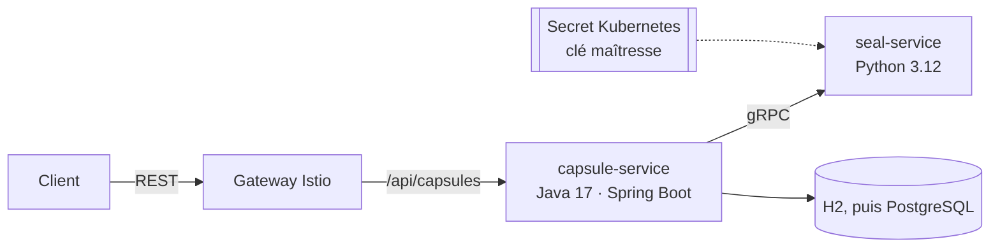

# Chronoseal

Chronoseal permet de déposer un message qui ne pourra être lu qu'à une date
choisie. Avant cette date, personne ne peut l'ouvrir, même avec un accès direct
à la base de données. Une fois la capsule ouverte, n'importe qui peut vérifier
que le message n'a pas changé depuis le dépôt.

Projet d'Ali Kafagy, en binôme avec Ahmed Kafagy, pour le projet Cloud 2026.
On s'en sert aussi pour faire les TP de DevOps.

## L'idée

Si c'est l'API qui vérifie la date, il suffit de lire la base pour tricher. On a
donc séparé le travail en deux services. `capsule-service` reçoit les requêtes
et stocke les capsules, mais n'a jamais la clé. `seal-service` a la clé et
refuse de déchiffrer avant l'heure.

La date d'ouverture est liée au chiffré. Si quelqu'un la modifie en base, la
capsule ne s'ouvre pas plus tôt, elle devient illisible.

Quelques usages : une lettre à soi-même dans cinq ans, des pronostics entre
amis, un sujet d'examen sous embargo, des offres remises sous pli scellé.

## Architecture



| Service | Techno | Port | Rôle |
|---|---|---:|---|
| `capsule-service` | Java 17, Spring Boot 3.5, JPA | 8080 (REST) | API publique, validation, stockage du chiffré |
| `seal-service` | Python 3.12, grpcio, cryptography | 50051 (gRPC) | chiffrement AES-256-GCM et contrôle de la date |

La crypto, le modèle de menace et nos choix sont expliqués dans
[docs/architecture.md](docs/architecture.md).

## API

| Méthode | Chemin | Réponse |
|---|---|---|
| `POST` | `/api/capsules` | 201, avec l'empreinte SHA-256 du message |
| `GET` | `/api/capsules` | les métadonnées de toutes les capsules, sans contenu |
| `GET` | `/api/capsules/{id}` | les métadonnées d'une capsule |
| `GET` | `/api/capsules/{id}/content` | 423 avant la date, puis le message et le sel |

```bash
curl -s -X POST http://localhost:8080/api/capsules \
  -H 'Content-Type: application/json' \
  -d '{"title": "Pronostic", "author": "ali", "message": "La France gagne 2-1", "unlockAt": "2030-07-19T21:00:00Z"}'
```

À l'ouverture, `SHA-256(sel || message)` doit redonner l'empreinte reçue au
dépôt. Les erreurs sont au format `application/problem+json`.

## Lancer le projet

Il faut Docker, un JDK 17 et Python 3.12.

> Clonez le dépôt dans un dossier dont le chemin ne contient pas de `:`. Java
> s'en sert comme séparateur et Gradle ne marche plus.

```bash
python3 scripts/project.py prerequisites
```

Pour lancer les deux services et tester le parcours complet :

```bash
python3 scripts/project.py compose-up
python3 scripts/project.py smoke
python3 scripts/project.py compose-down
```

Si le port 8080 est déjà pris, ajoutez `CAPSULE_HTTP_PORT=18080` devant les deux
premières commandes.

Pour rejouer en local les mêmes contrôles que la CI (tests, Checkstyle, Ruff et
versions épinglées) :

```bash
python3 -m venv .venv && . .venv/bin/activate
pip install -r apps/seal-service/requirements-dev.txt
python scripts/project.py verify
```

Le déploiement sur Minikube avec Istio est décrit dans
[docs/deploiement.md](docs/deploiement.md).

## Le dépôt

```text
apps/capsule-service/   API REST en Java
apps/seal-service/      service gRPC en Python
proto/                  contrat gRPC commun aux deux services
k8s/base/               manifestes Kustomize et gateway Istio
k8s/overlays/minikube/  variante locale avec des images construites dans Minikube
scripts/project.py      commandes locales, les mêmes que dans la CI
docs/                   architecture et déploiement
.github/                workflows et Dependabot
```

## Avancement

On suit le barème du sujet Cloud. Chaque TP DevOps a sa propre branche, fusionnée
ensuite dans `main`.

| Étape | Contenu | État |
|---|---|---|
| Cloud 10/20 | service REST, image Docker, Deployment et Service | fait |
| Cloud 12/20 | gateway Istio | fait |
| Cloud 14/20 | deuxième service relié en gRPC, Docker Compose | fait |
| Cloud 16/20 | persistance JPA sur H2 en mémoire | fait |
| | PostgreSQL dans le cluster et volume persistant | à faire |
| Cloud 18/20 | RBAC, mTLS strict, images signées vérifiées, HTTPS | à faire |
| Cloud 20/20 | déploiement dans un cloud | à faire |
| Option | front-end | à faire |
| TP01 DevOps | CI observable et bloquante, branche `tp/01-ci` | fait, tag `checkpoint/01-ci` |
| TP02 DevOps | preuves des images, branche `tp/02-supply-chain` | fait, tag `checkpoint/02-supply-chain` |

Pour la partie sécurité, une partie du travail est déjà là : conteneurs non-root
en lecture seule, un ServiceAccount par service, clé hors du dépôt et sondes de
santé.

## CI

| Workflow | Jobs |
|---|---|
| `CI - capsule-service` | Java tests, Java quality, Java Docker image, Java supply chain |
| `CI - seal-service` | Python tests, Python quality, Python Docker image, Python supply chain |
| `CI - repository security` | Secret detection, Supply-chain policy |
| `CI - dependency review` | Dependency review (sur les PR) |

Les images sont publiées sur GHCR uniquement depuis `main`. Elles sont ensuite
signées avec Cosign, accompagnées d'un SBOM et d'une attestation de provenance,
puis scannées par Trivy sur leur digest.

## Commits

Chaque commit commence par l'étape qu'il traite : `[Cloud 14/20]` pour le barème
du projet, `[TP01 §2]` pour une section d'un TP. Pour relire tout un TP, il suffit
de filtrer l'historique, par exemple `git log --oneline --grep 'TP02'`.
