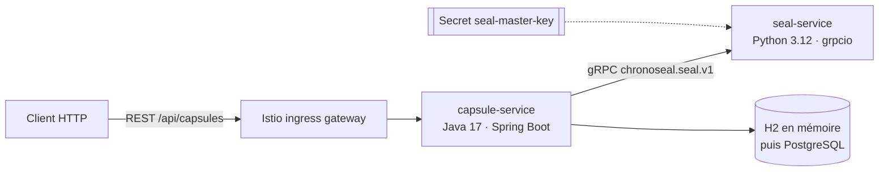
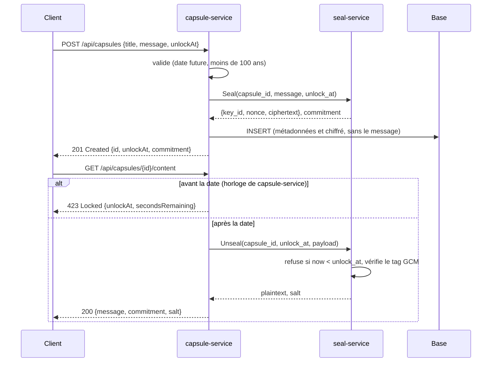

# Architecture et sécurité

## Composants

| Composant | Ce qu'il fait | Ce qu'il ne fait pas |
|---|---|---|
| Gateway Istio | seul point d'entrée, route `/api/capsules` | n'expose ni Actuator ni seal-service |
| `capsule-service` | API REST, validation, stockage | n'a jamais la clé et ne stocke jamais le message en clair |
| `seal-service` | chiffre, déchiffre, vérifie la date | ne stocke rien, donc on peut le répliquer |
| Secret Kubernetes | contient la clé maîtresse (32 octets) | n'est jamais versionné |

## Dépôt et ouverture d'une capsule

## La crypto

Chaque capsule a sa propre clé, dérivée de la clé maîtresse avec HKDF-SHA256
(info `chronoseal/seal/v1/<id>`). Deux capsules n'ont donc jamais la même clé.
Le message est chiffré en AES-256-GCM avec un nonce aléatoire de 96 bits.

L'identifiant et la date d'ouverture (`"<id>|<date en secondes>"`) sont passés
en données associées. Ils ne sont pas chiffrés, mais ils sont authentifiés : si
l'un des deux change, le déchiffrement échoue.

Au dépôt, seal-service renvoie aussi une empreinte, `SHA-256(sel || message)`,
avec un sel aléatoire de 16 octets scellé avec le message. Après l'ouverture, on
recalcule l'empreinte pour vérifier que le message n'a pas changé. Le sel évite
qu'on devine un message court (« oui », « non », un score) en essayant toutes
les possibilités.

## Ce qu'on protège, et contre qui

| Attaquant | Ce qu'il essaie | Ce qui se passe |
|---|---|---|
| Quelqu'un qui lit la base | lire les messages | impossible, seul le chiffré est stocké |
| Admin de la base | avancer `unlock_at` pour ouvrir plus tôt | `DATA_LOSS`, la date est authentifiée |
| Admin de la base | copier le chiffré d'une capsule ouverte dans une autre | échec, la clé et les données associées dépendent de l'id |
| `capsule-service` compromis | appeler `Unseal` avant la date | `FAILED_PRECONDITION`, seal-service suit sa propre horloge |
| Écoute du réseau du cluster | lire les échanges gRPC | mTLS du service mesh (mode strict prévu au 18/20) |
| Accès à la clé maîtresse | tout déchiffrer | la crypto ne peut rien, d'où l'isolement de seal-service (RBAC et AuthorizationPolicy prévus) |

Aucun schéma ne tient si la clé maîtresse fuite. On a donc concentré ce risque
dans un seul petit service sans état, plus facile à isoler que le reste.

## Le contrat gRPC

`proto/chronoseal/seal/v1/seal.proto` est la seule définition de l'interface.
Java et Python génèrent leur code à partir de ce fichier à chaque build, et le
code généré n'est pas versionné.

| Code gRPC | Cas | Réponse REST |
|---|---|---|
| `INVALID_ARGUMENT` | id, contenu ou date invalide | 502 (la validation REST aurait dû l'arrêter avant) |
| `FAILED_PRECONDITION` | date pas encore atteinte | 423 Locked |
| `DATA_LOSS` | chiffré, id ou date modifiés | 500 |
| `NOT_FOUND` | clé maîtresse inconnue | 500 |
| `UNAVAILABLE`, `DEADLINE_EXCEEDED` | service injoignable ou trop lent (3 s) | 503 |

## Pourquoi ces choix

REST à l'extérieur et gRPC à l'intérieur. L'API publique doit rester simple à
appeler, avec curl, un navigateur ou un futur front. Entre les services, gRPC
apporte un contrat typé et versionné, des codes d'erreur précis, un délai par
appel et une sonde de santé que Kubernetes sait interroger.

Deux langages, parce que chaque service prend ce qui lui va le mieux : Spring
Boot pour l'API et la persistance, la bibliothèque `cryptography` de Python pour
le chiffrement. C'est aussi la structure du dépôt de TP, avec un service Java et
un service Python.

Le contrat reste à la racine du dépôt et les images le reçoivent avec
`--build-context proto=proto`. Pas besoin d'en garder une copie par service.

## Limites connues

Avec H2 en mémoire, `capsule-service` tourne sur une seule réplique et les
capsules disparaissent au redémarrage. PostgreSQL arrive avec l'étape 16/20.

Pour la rotation de clé, `key_id` est déjà prévu dans le format. Mais re-sceller
une capsule encore fermée demandera une opération interne qui ne passe pas par
`Unseal`.

C'est l'horloge de seal-service qui décide. Si l'horloge d'un nœud dérive, les
capsules s'ouvrent trop tôt ou trop tard, il faut donc NTP sur les nœuds.
