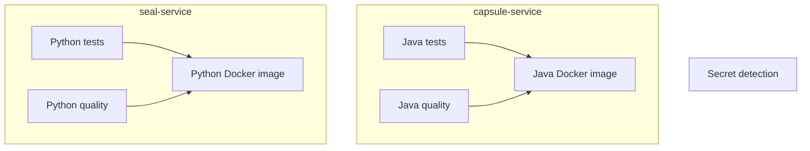

# TP01 : une CI observable et bloquante

Ali Kafagy et Ahmed Kafagy, en binôme.

On a fait le TP01 sur Chronoseal plutôt que sur le dépôt `rental` du cours. Nos
deux services jouent le même rôle que ceux du cours :

| Cours (`rental`) | Chronoseal | Qualité |
|---|---|---|
| `car-rental-service` (Java, Gradle) | `capsule-service` | Checkstyle |
| `pricing-service` (Python) | `seal-service` | Ruff |

Le travail est sur la branche `tp/01-ci`, fusionnée ensuite dans `main`. Les
commits commencent par `[TP01 §n]`, n étant la section de l'énoncé.

## 0. Lecture des workflows

| Job | Ce qu'il protège | Entrées | Sortie | Coût en local |
|---|---|---|---|---|
| Java tests | régressions REST, gRPC ou JPA | sources Java, `proto/` | rapports JUnit | ~1 min 40 s à froid, téléchargement de Gradle compris |
| Java quality | code hors des règles | sources Java sans le code généré | rapports Checkstyle | ~15 s |
| Java Docker image | livrable qui ne se construit pas | Dockerfile, sources, `proto/` | image (publiée seulement depuis `main`) | dépend du cache BuildKit |
| Python tests | régressions du scellement ou des codes gRPC | sources Python, `proto/` | rapport JUnit pytest | moins d'1 s de tests, l'installation domine |
| Python quality | lint ou formatage | sources Python, `scripts/` | messages dans le log | quelques secondes |
| Python Docker image | livrable qui ne se construit pas | Dockerfile, sources, `proto/` | image (publiée seulement depuis `main`) | dépend du cache BuildKit |
| Secret detection | secret ajouté à l'historique | tout l'historique Git | rapport Gitleaks | quelques secondes |

Les durées sur GitHub Actions seront notées après la première exécution.

## 1. Observer un échec

On a cassé une assertion exprès (`[TP01 §1] Casse volontairement une assertion
pour observer l'échec`), puis on l'a remise (`[TP01 §1] Rétablit l'assertion
après diagnostic`). Le test attendait une empreinte de 63 caractères au lieu
de 64.

Réponses, d'après la reproduction locale (`python scripts/project.py test-python`) :

1. Le premier job en échec est `Python tests`. Java, Checkstyle et Ruff ne sont
   pas concernés, et `Python Docker image` ne se lance pas puisqu'il dépend des
   tests.
2. La ligne utile est plus haut que la dernière ligne rouge, qui dit seulement
   que pytest a échoué :
   ```text
   tests/test_server.py:59: AssertionError
   >       assert len(sealed.commitment) == 63
   E       assert 64 == 63
   FAILED tests/test_server.py::test_round_trip_over_grpc - assert 64 == 63
   ========================= 1 failed, 31 passed in 0.16s =========================
   ```
3. Oui, il y a un rapport. L'upload est en `if: always()` et envoie
   `build/test-results/pytest.xml` même quand pytest échoue (artefact
   `python-test-reports`).
4. 36 s en local, installation comprise. Le temps sur GitHub reste à mesurer
   avec une PR en brouillon.

Pour rejouer ça sur GitHub, il suffit de pousser le commit qui casse le test sur
une branche jetable et d'ouvrir une PR en brouillon.

## 2. Portes qualité

Côté Java, on utilise Checkstyle 12.3.1, configuré dans
`apps/capsule-service/config/checkstyle/checkstyle.xml`.

| Demandé par le TP | Règle |
|---|---|
| imports inutilisés | `UnusedImports`, avec `AvoidStarImport` et `RedundantImport` |
| accolades obligatoires | `NeedBraces` |
| instructions vides | `EmptyStatement`, avec `EmptyCatchBlock` |
| longueur de ligne | `LineLength` (140) |

On a ajouté quelques règles (`EqualsHashCode`, `FallThrough`,
`MissingSwitchDefault`, `ModifierOrder`, `StringLiteralEquality`...). Le
moindre avertissement fait échouer le build (`maxWarnings = 0`). Le code généré
depuis `proto/` n'est pas vérifié, puisqu'on ne l'écrit pas nous-mêmes. Pour
tester la porte, on a ajouté un import inutile et obtenu `BUILD FAILED` avec
`Import inutilisé - java.util.Map. [UnusedImports]`.

Côté Python, c'est Ruff 0.17.6 avec E, F et I comme demandé, plus UP, B et SIM.
Le formatage est vérifié avec `ruff format --check` et le dossier `gen/` est
exclu. Deux corrections ont suffi, sans désactiver de règle : une ligne trop
longue dans `app/server.py` (E501) et un `.encode()` remplacé par un littéral
`b"..."` dans un test (UP012).

Ruff vérifie aussi `scripts/project.py`, en ciblant Python 3.9. Ça a révélé un
vrai bug : le script importait `datetime.UTC` (Python 3.11+), donc
`prerequisites` plantait sur un vieux Python au lieu d'afficher que la version
était trop ancienne.

## 3. Graphe CI



Dans chaque workflow, chaque job a un `timeout-minutes`. Les permissions sont à
`contents: read`, et seul le job image a `packages: write`. L'image attend
`needs: [test, quality]`. On a un cache Gradle ou pip, un cache BuildKit par
service, et `concurrency` annule les exécutions dépassées. L'image n'est
publiée que sur un `push` vers `main`, une PR la construit sans la pousser.

On n'a pas mis de filtre `paths` sur les PR. Si un workflow requis ne se lance
pas parce qu'aucun fichier concerné n'a changé, GitHub attend un statut qui
n'arrive jamais et la PR reste bloquée. Sur `main`, le filtre évite de
reconstruire un service qui n'a pas bougé. `proto/` déclenche les deux
services, puisque le contrat les concerne tous les deux.

## 4. Preuves

| Artefact | Contenu | Rétention |
|---|---|---|
| `java-test-reports` | JUnit XML et rapport HTML Gradle | 7 jours |
| `java-quality-reports` | Checkstyle XML et HTML | 7 jours |
| `python-test-reports` | JUnit XML de pytest | 7 jours |

Ils sont envoyés avec `if: always()` et `if-no-files-found: error`.

## 5. Détection de secrets

Gitleaks tourne sur tout l'historique (`fetch-depth: 0`) dans le workflow
`CI - repository security`.

Notre secret critique, c'est la clé maîtresse de seal-service. Elle n'est
jamais dans le dépôt. Le Secret Kubernetes est créé à la main avec
`openssl rand -base64 32`, Compose utilise une clé jetable, et `.gitignore`
exclut `.env`, `*.key` et `*.pem`.

Si une clé fuitait, il ne faudrait pas confondre ces trois gestes :

| Geste | Effet | Suffisant ? |
|---|---|---|
| Supprimer la ligne | la clé disparaît du dernier commit | non, elle reste dans l'historique et dans tous les clones |
| Révoquer la clé | la valeur exposée ne protège plus rien | indispensable, et toujours en premier |
| Réécrire l'historique | la valeur disparaît du dépôt (`git filter-repo`, push forcé) | en complément, ça n'efface ni les clones, ni les forks, ni les caches |

Chez nous, révoquer la clé veut dire en créer une nouvelle (`key-id` différent)
et re-chiffrer les capsules. Sauf que seal-service refuse d'ouvrir une capsule
avant sa date. Il faudra donc une opération interne de re-chiffrement qui ne
passe pas par `Unseal`. C'est noté pour la suite.

## 6. Reproduire en local

```bash
python scripts/project.py verify
```

`verify` lance les tests (Gradle puis pytest, après génération du code gRPC),
puis Checkstyle et Ruff. Il s'arrête au premier échec et renvoie `1`. On l'a
lancé sous Ubuntu 24.04 avec JDK 17 et Python 3.12 : code de sortie `0`.

Il ne construit pas les images, ne lance pas Gitleaks et ne touche pas à la
protection de branche. Ça reste dans GitHub Actions.

## 7. Protéger `main`

À faire une fois le dépôt publié et les contrôles passés au moins une fois. Les
contrôles requis sont `Java tests`, `Java quality`, `Java Docker image`,
`Python tests`, `Python quality`, `Python Docker image` et `Secret detection`.
Une PR rouge ne doit pas pouvoir être fusionnée, une PR verte oui.

## Texte de la pull request

> **TP01 : CI observable et bloquante**
>
> Chaque service a maintenant trois jobs : tests, qualité et image. L'image
> n'est construite que si les tests et la qualité passent, et n'est publiée que
> depuis `main`. Checkstyle et Ruff bloquent, leur config est dans le dépôt, et
> les rapports restent téléchargeables sept jours même en cas d'échec. Gitleaks
> inspecte tout l'historique. `python scripts/project.py verify` rejoue les
> mêmes contrôles en local.
>
> On n'a pas filtré les chemins sur les PR pour que les contrôles requis soient
> toujours là. Le code généré depuis `proto/` n'est pas vérifié par les
> linters, et une modification de `proto/` lance la CI des deux services.

## Critères d'acceptation

| Critère | Où le vérifier |
|---|---|
| Tests et qualité séparés et reproductibles en local | jobs `test` et `quality`, `scripts/project.py verify` |
| Graphe de dépendances et publication sûre des images | `needs`, condition `push` sur `main` |
| Rapports utilisables en cas d'échec | artefacts `*-test-reports` et `java-quality-reports` |
| Détection de secrets bien bornée | `ci-security.yml`, `fetch-depth: 0` |
| Permissions, timeouts, cache et concurrence | en-tête et jobs de chaque workflow |
| PR claire et commits lisibles | préfixes `[TP01 §n]`, texte ci-dessus |
