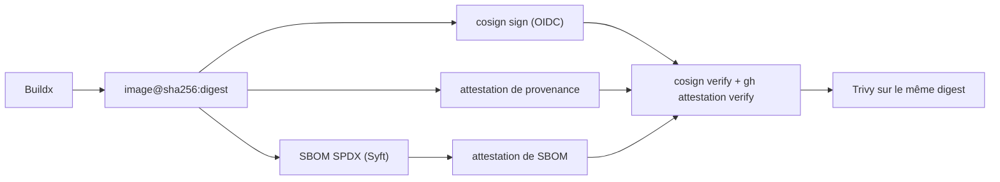

# TP02 : produire et vérifier les preuves d'une image

Ali Kafagy et Ahmed Kafagy, en binôme.

On a fait le TP02 sur Chronoseal, sur la branche `tp/02-supply-chain`. Elle part
de `main` après le TP01 (tag `checkpoint/01-ci`) et a été fusionnée ensuite. Les
commits commencent par `[TP02 §n]`.

## 0. Inventaire des références

Au tag `checkpoint/01-ci` :

| Référence | Exemple | Nature |
|---|---|---|
| Actions GitHub (9 actions, 23 lignes `uses:`) | `actions/checkout@v7` | mutable, un tag peut être déplacé |
| Images de base (4 `FROM`) | `python:3.12-slim` | mutable, le contenu derrière le tag change à chaque mise à jour |
| Images produites | `ghcr.io/.../seal-service:latest` | mutable par définition |
| Images produites | `ghcr.io/.../seal-service:sha-<commit>` | lisible, mais rien n'empêche de repousser ce tag |
| Distribution Gradle | `gradle-8.14-bin.zip` et `distributionSha256Sum` | immuable, le wrapper vérifie la somme |
| Dépendances Python | `cryptography==50.0.2` | version figée, mais sans hash, donc un fichier republié sous le même numéro passerait |

À la fin du TP, toutes les actions et toutes les images de base sont figées.

## 1. Modèle de risques

| Élément | Substitution possible | Impact | Ce qu'on a mis en place |
|---|---|---|---|
| Action GitHub | le tag `v7` est déplacé vers un commit malveillant | code arbitraire avec `packages: write`, donc une image piégée publiée sous notre nom | SHA complet et Dependabot (§2), politique locale et en CI (§3) |
| Image de base | le contenu derrière `python:3.12-slim` est remplacé | une porte dérobée entre dans l'image sans aucun changement dans le dépôt | digest dans chaque `FROM` et Dependabot (§2) |
| Image produite | `latest` est repoussé après le scan | on déploie autre chose que ce qui a été testé | signature, provenance et SBOM sur le digest (§6), scan du même digest (§7) |
| Dépendance | une version vulnérable de `cryptography` ou `grpc` arrive | faille dans le service qui a la clé maîtresse | revue des dépendances sur les PR (§4), Dependabot pip et Gradle |

Le dernier point compte beaucoup chez nous. seal-service est le seul à manipuler
la clé maîtresse, donc une dépendance piégée dans ce service suffit à exposer
toutes les capsules.

## 2. Épingler les références

Les 23 lignes `uses:` sont passées en `owner/action@<sha40> # vX.Y.Z`, et on a
vérifié que chaque SHA correspond au tag écrit en commentaire. Les 4 `FROM` ont
un digest d'index multi-architecture (amd64 pour la CI, arm64 pour nos Mac), et
les deux images ont été reconstruites après.

Dependabot suit `github-actions` et `docker` comme demandé, plus `pip` et
`gradle`. On ignore les montées majeures de Java, Gradle et Python, qu'on fera à
la main le moment venu.

## 3. Politique locale

```bash
python scripts/project.py supply-chain-policy
```

La commande échoue si une action n'a pas de SHA complet, si une image
`docker://` n'a pas de digest ou si un `FROM` externe n'en a pas. Un `FROM` vers
une étape précédente du même Dockerfile est accepté. `verify` la lance après les
tests et les linters, et le job `Supply-chain policy` la rejoue sur chaque PR.

On l'a testée dans une copie de travail :

```text
ERREUR : Politique de chaîne logicielle non respectée :
.github/workflows/ci-security.yml:29: action actions/checkout@v7 non épinglée par un SHA complet
.github/workflows/ci-security.yml:37: image docker://alpine:3.20 sans digest SHA-256
apps/capsule-service/Dockerfile:22: image eclipse-temurin:17-jre-jammy sans digest SHA-256
```

Code de sortie `1`, puis `OK politique de chaîne logicielle` une fois les
fichiers remis en place.

## 4. Revue des dépendances

Le workflow `CI - dependency review` tourne seulement sur les PR, avec le seuil
`high`. Il faut activer le graphe de dépendances et les alertes Dependabot dans
*Settings > Security* du dépôt.

Dependency review ou Trivy ? La revue compare les manifestes avant et après la
PR. Elle empêche d'ajouter une dépendance vulnérable avant la fusion, mais elle
ne voit que ce qui est déclaré. Trivy regarde l'image finale : les paquets de
l'image de base, les dépendances transitives vraiment présentes, le JRE. Il
trouve aussi une faille publiée après la fusion, alors que rien n'a changé dans
le dépôt.

## 5 à 7. SBOM, signature, attestations, vérification

C'est le job `Java supply chain` (ou `Python supply chain`), lancé seulement
après une publication sur `main` :



Le digest vient directement de la sortie `digest` de `docker/build-push-action`.
Le nom d'image est passé en minuscules, parce qu'un nom OCI n'accepte pas les
majuscules alors que le nom du dépôt GitHub en a. Il n'y a ni clé privée ni
secret de signature, Cosign utilise l'identité OIDC temporaire du workflow. Le
job vérifie ses propres preuves avant de lancer Trivy, donc une signature ou une
attestation manquante fait échouer le pipeline.

## 8. Lire les preuves

À compléter après la première exécution réussie sur `main`.

| Preuve | Valeur | Comment l'obtenir |
|---|---|---|
| Digest vérifié | *à relever* | sortie `digest` du job image, ou `docker buildx imagetools inspect ghcr.io/tacoao/chronoseal/seal-service:latest` |
| Identité du certificat Cosign | *à relever* (attendu : `https://github.com/Tacoao/chronoseal/.github/workflows/ci-seal.yml@refs/heads/main`) | `cosign verify ... \| jq '.[0].optional'` |
| Dépôt et commit de la provenance | *à relever* | `gh attestation verify oci://<image@digest> --repo Tacoao/chronoseal --format json` |
| Deux composants du SBOM | *à relever* (une bibliothèque et un paquet système) | `jq -r '.packages[] \| "\(.name) \(.versionInfo)"' python-sbom.spdx.json` |
| Rapport Trivy | *lien à relever* | onglet *Security > Code scanning*, catégories `trivy-seal-service` et `trivy-capsule-service` |

Pour seal-service, `cryptography` (bibliothèque Python) et `libssl3` (paquet
Debian) sont de bons exemples, les deux servent au chiffrement des capsules.

## Limites et suite

Les dépendances Python et Gradle ne sont pas verrouillées par hash
(`pip --require-hashes`, verrouillage Gradle), pas plus que les plugins `protoc`
et `protoc-gen-grpc-java` téléchargés par Gradle.

Kubernetes déploie encore `latest`. Le déploiement par digest et le refus des
images non signées (policy-controller de Sigstore ou Kyverno) viendront avec
l'étape sécurité du projet Cloud (18/20).

## Critères d'acceptation

| Critère | Où le vérifier |
|---|---|
| Actions et images de base immuables | `supply-chain-policy`, commits §2 |
| Politique locale et Dependabot | `scripts/project.py`, `.github/dependabot.yml` |
| SBOM SPDX lié au bon digest | artefacts `java-sbom.spdx.json` et `python-sbom.spdx.json` |
| Signature sans clé vérifiable | étape `Verify signature and attestations` |
| Provenance et attestation SBOM | étapes `Attest build provenance` et `Attest SBOM` |
| Permissions minimales et vérification finale | bloc `permissions` du job `supply-chain` |
| Analyse argumentée des preuves | sections 1, 4 et 8 |
